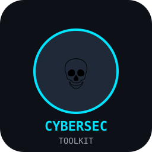

# 💀 CyberSec Toolkit


A Python-based cybersecurity assessment toolkit for **authorized** testing of your own infrastructure. Terminal-first CLI with modular scanners and reporting.



## Modules

| Module | Description |
|---|---|
| **Network Scanner** | Host discovery, port scan, service/version detection via nmap |
| **Local IP Scanner** | LAN sweep (ARP/ping) |
| **Web Vuln Scanner** | Security headers, CORS, forms, SQLi/XSS probes, sensitive files, open redirect |
| **hping3 Wrapper** | TCP SYN / UDP / ICMP flood for stress-testing own servers |
| **CVE Lookup** | Live CVE search via NVD API (CVSS + descriptions) |
| **Remote Health** | SSH-based server monitoring (uptime, CPU, mem, disk, services, ports) |
| **Reporter** | JSON + HTML reports |

## Install

### Windows
1. Python 3.10+ (python.org, add to PATH).
2. `pip install -r requirements.txt`
3. Nmap: https://nmap.org/download.html
4. hping3: use WSL/VM (Linux) — native Windows nahi hai.

### Linux (Ubuntu/Debian)
```bash
sudo apt update
sudo apt install -y python3 python3-pip nmap hping3
git clone https://github.com/abid8670/cybersec-toolkit.git
cd cybersec-toolkit
pip3 install -r requirements.txt
python3 main.py --help
```

## Usage

```bash
python main.py --help
python main.py scan-network 192.168.0.0/21 --ports 1-1024
python main.py scan-web https://target.example
python main.py cve "apache 2.4" --limit 10
python main.py hping 192.168.0.4 --mode syn --count 1000 --flood
python main.py remote-health 192.168.0.4 -u root -p <password>
python main.py full 192.168.0.0/21 --web
```

## Authorization

Only scan systems you own or have written permission to test. Unauthorized scanning is illegal.

## Roadmap

- Subdomain enumeration (crt.sh)
- Directory brute-force
- SSL/TLS audit
- DNS zone transfer check
- Reverse-shell *detection* rules (defensive)
- Async scanning

## Author

Abid Iqbal — [github.com/abid8670](https://github.com/abid8670)
